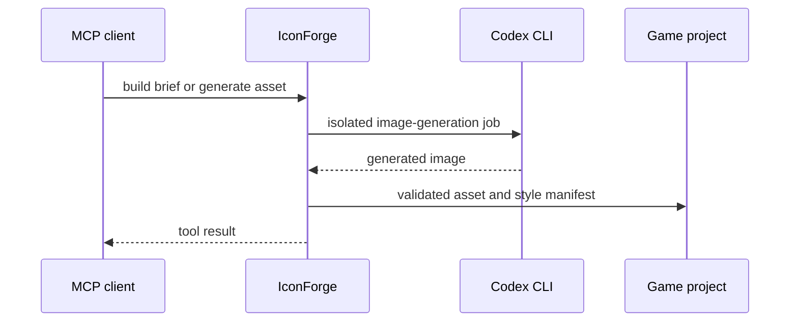

# IconForge MCP

**A project-aware MCP server for generating game art with Codex image generation.** IconForge turns structured briefs into icons, HUD art, brand marks, banners, textures, and cohesive asset families, then saves validated outputs into your project.

It uses the Model Context Protocol over stdio and delegates image creation to the locally installed Codex CLI. It has no npm runtime dependencies.

## What it does

- Builds and validates briefs before starting an image-generation job.
- Generates focused assets for game interfaces and art workflows.
- Creates cohesive style sets with shared visual constraints, persistent manifests, and follow-up extensions.
- Validates project-relative output paths and generated image files before copying them into the project.
- Bounds concurrent jobs and runs each generation in an isolated Codex home.



## Requirements

- Node.js 18 or newer
- Codex CLI installed and authenticated
- The Codex image-generation capability and its `imagegen` skill available in the configured Codex home
- An MCP client that supports stdio servers; the included example uses Oh My Pi (OMP)

## Quick start

Clone the repository and copy the example project profile into the game project that will receive generated assets:

```bash
git clone https://github.com/lefthandeddev/icon-forge-mcp.git
cd icon-forge-mcp
mkdir -p /path/to/game-project/.omp/icon-forge
cp examples/project.json /path/to/game-project/.omp/icon-forge/project.json
```

Set `CODEX_HOME` to the authenticated Codex home directory. Add IconForge to your MCP client using the absolute path to `server.mjs`. An OMP configuration example is in [`examples/omp.mcp.json`](examples/omp.mcp.json).

By default, IconForge treats the MCP server's working directory as the game project. If your client starts the server from another directory, set `ICON_FORGE_PROJECT_ROOT` to the game project's absolute path.

After restarting the MCP client, start with a `build_*_brief` tool to inspect the validated request, then call the matching `generate_*` tool.

## Project profile

Every target project needs `.omp/icon-forge/project.json`. The example file is intentionally generic:

```json
{
  "schemaVersion": 1,
  "projectName": "Your Project",
  "artDirection": "Describe the visual direction, materials, palette, and lighting.",
  "generatedAssetRoot": "Assets/Art/Generated",
  "categories": ["ui", "icons", "branding", "environment"]
}
```

`generatedAssetRoot` must be a safe project-relative path. IconForge rejects invalid profiles and unsafe paths rather than writing outside the project.

## MCP tools

### Focused assets

| Tool | Purpose |
|---|---|
| `build_hud_icon_brief` / `generate_hud_icon` | Validate a HUD icon brief, then generate an icon |
| `build_brand_mark_brief` / `generate_brand_mark` | Validate and generate a brand mark |
| `build_banner_brief` / `generate_banner` | Validate and generate a banner |
| `build_texture_brief` / `generate_texture` | Validate and generate a seamless texture |

### Style sets

| Tool | Purpose |
|---|---|
| `build_asset_style_set_brief` / `generate_asset_style_set` | Plan and generate a cohesive asset family |
| `build_asset_style_extension_brief` / `generate_asset_style_extension` | Plan and add an item to an existing style set |
| `list_asset_style_sets` | List the style sets saved for the project |

Brief-building tools return the validated design information and generation guidance before any image is created. Style-set manifests are stored under `.omp/icon-forge/styles/`; temporary lock files are stored under `.omp/icon-forge/style-locks/`.

## Configuration

| Variable | Default | Description |
|---|---:|---|
| `CODEX_HOME` | Required | Authenticated Codex home with image-generation resources |
| `CODEX_BIN` | `codex` | Codex executable or absolute path to it |
| `ICON_FORGE_PROJECT_ROOT` | Current working directory | Existing project directory for profiles and generated assets |
| `ICON_FORGE_MAX_CONCURRENT_GENERATIONS` | `2` | Concurrent generation limit (`1`–`4`) |
| `ICON_FORGE_TIMEOUT_MS` | `240000` | Per-generation timeout in milliseconds (`1000`–`600000`) |
| `ICON_FORGE_SLOT_WAIT_MS` | Generation timeout | Maximum wait for a generation slot (`1000`–`3600000` ms) |

The MCP protocol default is `2024-11-05`; IconForge also accepts `2025-03-26` and `2025-06-18`.

## Development

There are no runtime or development dependencies to install.

```bash
npm test
```

The test suite uses a fixture Codex executable and does not require live image-generation credentials or make model calls.

## Security notes

- Do not commit a real `CODEX_HOME`, credentials, or personal MCP-client configuration. The example config contains placeholders only.
- Generation runs use private per-job Codex homes. IconForge validates generated files and project-relative output paths before copying results into the target project.
- Treat generated assets as drafts: review content, transparency, dimensions, and licensing before shipping them in a game or product.

## License

MIT. See [`LICENSE`](LICENSE).
